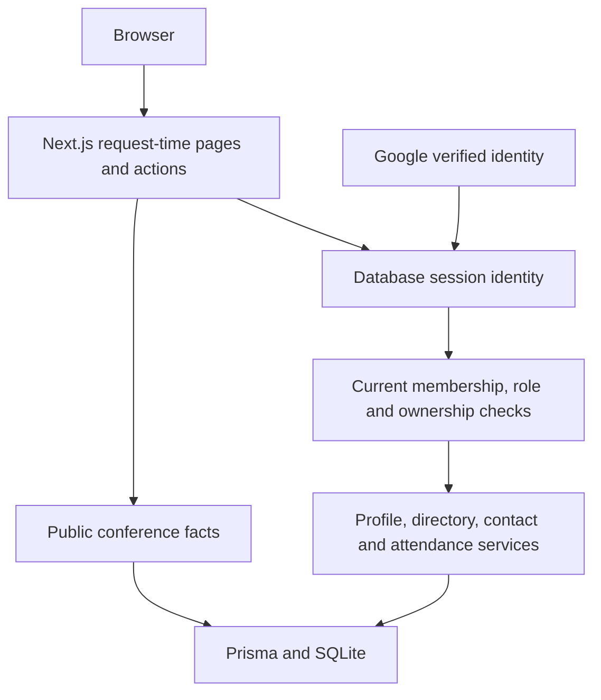

# IIM PhD & FPM Alumni Network — Master Project Overview

Version: 1.1 · Updated: 11 October 2026  
Status: P0–P1B implemented locally; final verification recorded in [implementation checks](docs/IMPLEMENTATION_CHECKS.md). No production deployment or live OAuth verification is claimed.  
Source baseline: `3a0f40a` plus the current working changes.

This keeps the café handoff's eight-part structure and its small-pilot, editorial, provenance, and hosting-aware approach. The reusable [planning skill](skills/community-platform-planning/SKILL.md) preserves that method. [PLAN.md](PLAN.md) separates completed local work from later phases.

## 1. Executive summary and purpose

An independent community for IIM PhD/FPM scholars and alumni, starting with a proposed IIM Lucknow pilot. The implemented foundation supports reviewed membership, a private opt-in directory, recipient-reviewed contact introductions, and individually authenticated conference attendance.

| Café principle | Implementation or planned adaptation |
| --- | --- |
| Focused, useful catalogue | Conference list/details exist; curator publication and verified provenance are P1C |
| Source/date/reviewer evidence | Membership decisions record reviewer, method, reason and time; event provenance remains P1C |
| Guest-first public discovery | Public conference facts; private membership, profiles, contacts and rosters |
| Editorial independence | No paid boosts; event inclusion methodology is part of P1C/P2 |
| Bounded pilot | Proposed 15–25 consenting members and 10–20 verified events; not recruited or populated |
| Modest infrastructure | One Node process with persistent SQLite storage; isolated verification databases |
| Lightweight accessible reading | Server-rendered pages, system fonts, labelled forms, keyboard focus and responsive layout |

## 2. Technical stack and deployment decision

| Layer | Current implementation |
| --- | --- |
| Application | Next.js 16.4 / React 19.3 / TypeScript, App Router |
| Runtime and dependency management | Node 24, npm and committed package-lock; explicit Webpack dev/build |
| Database | Prisma/client 6.19.3, SQLite via `DATABASE_URL`, committed initial migration |
| Identity | NextAuth database sessions; Google-only verified mailbox identity |
| Authorization | Live database membership, role and ownership checks in shared services |
| Presentation | Tailwind PostCSS plus shared CSS; no remote fonts or decorative image requests |
| Quality | Node service tests, Playwright browser workflows, isolated production build, GitHub Actions |

The selected local/pilot architecture is a single persistent Node server with SQLite, documented in [HOSTING_DECISION.md](docs/HOSTING_DECISION.md). It replaces the earlier provisional PostgreSQL assumption for this milestone. An ephemeral/serverless filesystem or multiple write instances require a new database decision and migration. PHP-only shared hosting remains a separate rewrite, not the deployment target of these changes. Vendor, domain, budget and named production operator remain unassigned.

The lockfile now includes platform-specific native dependencies for Mac and Linux. Webpack is used consistently for dev, build and browser verification. The redundant Yarn lockfile was removed; it remains recoverable from Git history.

## 3. Architecture and request lifecycle



### Important paths

```text
src/app/
├── api/auth/[...nextauth]/route.ts  # Google authentication, private/no-store responses
├── signin/                         # Config-aware sign-in
├── membership/                     # Application and current status
├── admin/members/                  # Administrator-only review
├── profile/                        # Own profile, consent, withdrawal, deletion
├── directory/                      # Private search, filters and pagination
├── contacts/                       # Recipient-reviewed introductions
└── conferences/                    # Public facts; authorized per-member RSVP/roster
src/lib/
├── auth-policy.ts                  # Verified identity, exact domains, safe callbacks
├── auth.ts / session.ts            # Shared auth and live session-user lookup
├── validation.ts                   # Bounded fields and controlled research/method tags
├── member-service.ts               # Membership, ownership, consent and DB operations
└── prisma.ts                       # Shared client; sensitive query logging disabled
prisma/
├── schema.prisma
├── migrations/                     # Initial schema, constraints and indexes
└── seed.ts                         # Explicitly guarded synthetic event only
scripts/                            # Safe migration, isolated checks, first-admin bootstrap
tests/                              # Service/auth tests and browser scenarios
.github/workflows/check.yml         # Install, checks and Chromium workflows
```

### Identity and membership

Google's verified-mailbox claim and normalized email must match. Personal mailboxes may apply through manual review; exact academic-domain matching is only affiliation evidence. No suffix or domain automatically grants membership. Unsafe email-based account linking is disabled. LinkedIn is deferred.

A new identity is pending with a private profile. An operator can designate the first administrator only for an existing verified Google account; subsequent decisions use the admin review interface. Administrators record a method and reason. Curators cannot read application evidence or review membership.

Session cookies identify the actor; all member operations read current status from the database. Pending, rejected and suspended identities cannot access member features. They retain their own membership status and privacy/deletion controls.

### Member flows

Profile actions derive the owner from the session. Directory reads select only approved, explicitly visible profiles and safe fields. Email, verification evidence, OAuth accounts and sessions are excluded.

Contact requests require both participants to opt in. A sender expressly supplies a reply email, hidden from the recipient until acceptance. No account email is automatically disclosed. The recipient can decline or close a request; the sender can cancel. Withdrawal or suspension cancels active requests and removes shared addresses. Messages are limited in size and senders are limited to five requests per day. This is an introduction mechanism, not private messaging.

RSVP uses an explicit attendance intent, the current approved member, and a unique user/event relation. Public pages never return private counts or attendee identities. Approved members see only attendees whose directory profiles are visible. Private pages and session navigation render per request; withdrawal revalidates directory, contact and conference routes.

## 4. Data models and integrity

| Model | Responsibility / safeguards |
| --- | --- |
| User | Identity, pending/approved/rejected/suspended membership, member/curator/admin role, private evidence, self-reported profile, visibility and contact consent |
| Account / Session / VerificationToken | OAuth identity and database sessions; cascade on account deletion |
| MembershipReview | Reviewer/target, previous/new status and role, method, minimal reason and timestamp; target notes are redacted on deletion |
| ContactRequest | Sender/recipient, bounded introduction, explicit reply address, pending/accepted/declined/cancelled status |
| Conference | Existing event facts; provenance/publication model remains P1C |
| ConferenceAttendee | User/event foreign keys, attending/considering status, unique pair |

The migration enforces membership/role/programme/attendance/contact status sets, foreign keys, unique emails and RSVP pairs, and one active contact request per directed pair. Application validation bounds names, institutions, evidence, methods, batch years and search inputs. Methods and research domains use controlled lists.

Profile details are self-reported even when membership has been reviewed. Unknown optional values stay empty. Deleting an account removes identity, evidence, sessions, attendance and contacts; identifying target review notes are redacted and audit links are nulled. The last approved administrator must arrange a replacement first.

## 5. Pilot dataset and editorial operations

The seed creates one plainly labelled synthetic symposium and no identities. It requires explicit `ALLOW_DEMO_SEED=1`, `APP_ENV=local` or `test`, a SQLite file and a non-production runtime. Existing conference data is not rewritten by the seed. Real event publication requires the later P1C verification process.

The pilot targets remain 10–20 verified conference editions and 15–25 consenting members. They are targets, not existing participation. Do not scrape personal profiles or silently import people.

P1C will introduce official event sources, checked dates, reviewers, edition identity, timezone/deadline semantics and correction history. Automated imports will later create reviewable drafts. Do not mechanically convert journal rankings into conference rankings.

## 6. Security and privacy

The original mock-identity RSVP and public-roster paths have been replaced. Server-side checks protect direct actions as well as navigation. Role/status changes are read on each operation, including already signed-in sessions.

Consent defaults are private/off. Contact address validation rejects mailto query injection, and link addresses are encoded. Withdrawal hides profiles and cancels shared contact details; it cannot retract information a recipient already copied. Account-deletion confirmation applies only to the session owner. The last-administrator guard protects continued operation.

Authentication is disabled with an explanatory message when credentials, secret or origin configuration is missing. Production sign-in requires HTTPS. No test login endpoint or bypass provider exists: browser tests create synthetic database sessions in an isolated database. Auth API responses are private/no-store. Secrets and all SQLite/journal artifacts are ignored; the broken NUL-containing ignore patterns have been repaired.

The dependency audit still reports high-severity transitive tooling/configuration advisories; see [the recorded risk](docs/HOSTING_DECISION.md). They remain a pre-pilot review item. A local test pass does not replace staging review or real-provider verification.

The R&R vault, document uploads, scraping, outreach and deployment remain outside this milestone.

## 7. Setup, deployment and recovery

Follow [GETTING_STARTED.md](GETTING_STARTED.md) for Node/npm installation, environment configuration, initial migration, Google callback configuration, first-admin designation and verification commands.

The migration wrapper creates a missing SQLite file exclusively, never truncates an existing file, then applies committed migrations. Existing prototype databases need a protected backup and an explicit upgrade rehearsal; this initial migration does not silently reset or import them. The earlier Git stash remains preserved.

Each service-test, browser-test and build invocation creates its own temporary database and overrides ambient database/auth values. Builds never depend on a real member database. CI runs the same commands; local execution does not claim remote CI has run.

Before P2, assign operator/curator roles, provision separate staging/production volumes and OAuth clients, validate HTTPS/private cookies, fix or assess outstanding dependencies, rehearse a consistent SQLite backup/restore, and record an exact release and rollback procedure. Proposed recovery targets remain a maximum 24 hours of data loss and a four-hour restore, subject to actual hosting validation. Preserve unrelated applications on any shared account.

## 8. Remaining roadmap

The requested implementation boundary is P1B. P1C is next: curated conference CRUD, suggestions, publication/provenance, date-aware filtering, and fuller event lifecycle rules. P2 is a controlled pilot with real OAuth/staging verification and consented recruitment. P3 adds reviewed ingestion only after curation works. P4 introduces opt-in collaboration and mentorship, with a separately designed R&R vault.

The architecture keeps the café project's documentation and operating discipline while adapting the public/private boundary to academic membership. Hosting purchases, institutional endorsement, live OAuth, production deployment, invitations and real datasets are not implied by the local implementation.
